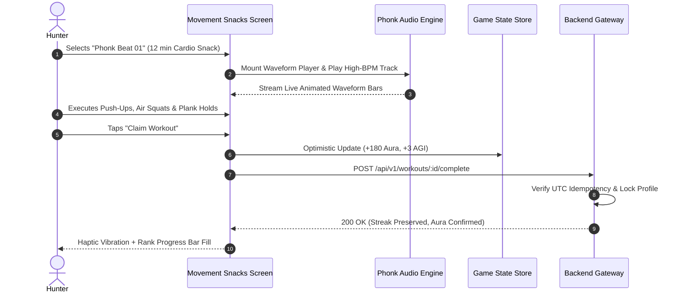
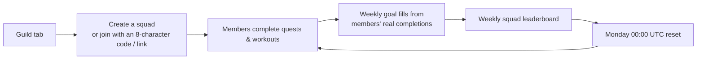

# AuraFit — RPG Gamified Fitness Platform

<p align="center">
  
</p>

<p align="center">
  <strong>Level Up Your Body. Claim Your Aura.</strong><br/>
  <em>A next-generation gamified fitness engine where Solo Leveling meets real-world habit building.</em>
</p>

<p align="center">
  
  
  
  
  
  
  
</p>

---

## ⚡ Overview

**AuraFit** transforms fitness into an immersive RPG journey inspired by the anime and manhwa *Solo Leveling*. Daily push-up sets, sprints, mobility drills, and curated high-intensity "Movement Snacks" earn **Aura Points**, power up four core RPG attributes (**STR**, **AGI**, **END**, **REC**), and advance users through seven hunter ranks from **E-Rank** to **Monarch**.

The platform is designed as an **npm workspaces monorepo** with a single shared domain engine powering two high-performance clients:
- 🌐 **Web**: An installable, responsive Progressive Web App built with **Next.js 15**, React 19, and standalone Docker deployment.
- 📱 **Mobile**: A native iOS and Android application built with **Expo SDK 57** and React Native, featuring deep obsidian aesthetics, offline-first local state fallback, and high-contrast WCAG-compliant typography.

---

## ✅ Feature Status (October 2026)

Everything below is live in production on the web (https://aurafit-alpha-one.vercel.app) and in the
Android production build (1.0.0, version code 3). The iOS build is pending (see [Release Status](#-release-status)).

| Feature | Web | Mobile | Highlights |
|---|:-:|:-:|---|
| **Starter workout library** | ✅ | ✅ | 10 official routines by AuraFit Coach so new users never see an empty feed |
| **Onboarding** | ✅ | ✅ | Goal + fitness level, reminder time, suggested first quest |
| **Streak-saver push** | — | ✅ | Hourly server job (pg_cron → `/api/cron/notifications`), Expo push, per-user timezone |
| **Squads** | ✅ | ✅ | Up to 5 hunters, invite codes / links, weekly goal from real completions, squad leaderboard, members-only activity |
| **Shareable rank cards** | ✅ | ✅ | 1080×1920 and square PNGs, public `/u/<handle>` page, native share sheet |
| **Creator tools** | ✅ | ✅ | Drop editor with scheduled publishing, edit/delete, analytics (7/30 days), follows, public `/c/<handle>` pages, All/Following feed |
| **Moderation** | ✅ | ✅ | Anonymous reports (drops + squads), admin queue (hide/restore, reset squad name, dismiss), aura anti-cheat flags with per-completion revert, suspend/unsuspend, role changes, permanent audit log |

Suspended accounts can still browse but every game action returns `403 SUSPENDED` with the moderator's reason.
Admins switch between **Moderation** and **Creator studio** on mobile Home.

---

## 🏛️ System Architecture

AuraFit decouples pure business and game domain logic from presentation layers, ensuring consistent calculations across web, mobile, and server environments.


> 📖 **Deep Dive**: See the full architectural specification, ER diagram, and caching strategy in [**`docs/ARCHITECTURE.md`**](docs/ARCHITECTURE.md).

---

## 🔄 User Flows & Core Game Loops

### 1. Hunter Daily Quest & Level-Up Loop


---

### 2. Movement Snacks & Phonk Beat Workout Drop



---

### 3. Squad Weekly Goal Loop



---

## 🎮 Game Engine & Business Logic Highlights

AuraFit's mechanics are mathematically formalized in `@aurafit/shared`:

### 1. Aura Progression Formula
$$\text{AuraEarned} = \text{round}\left( \frac{\text{BaseReward} \times \text{Multiplier} \times (100 + \min(\text{StreakDays} \times 5, 50))}{100} \right)$$
- Every consecutive workout day yields a **+5% boost** (up to a **+50% maximum** at 10+ days).

### 2. Hunter Rank Progression Ladder
| Rank | Threshold | Visual Theme | Next Milestone |
|---|:---:|---|---|
| **E-Rank** | `0 Aura` | Deep Obsidian & Metallic Silver | +1,000 to D-Rank |
| **D-Rank** | `1,000 Aura` | Slate Blue & Steel | +2,000 to C-Rank |
| **C-Rank** | `3,000 Aura` | Electric Cyan Glow | +4,000 to B-Rank |
| **B-Rank** | `7,000 Aura` | Neon Emerald Surge | +8,000 to A-Rank |
| **A-Rank** | `15,000 Aura` | Royal Violet Energy | +15,000 to S-Rank |
| **S-Rank** | `30,000 Aura` | Crimson Flame Aura | +30,000 to Monarch |
| **Monarch** | `60,000 Aura` | Gold & Shadow Amethyst | Pinnacle Hunter Realm |

### 3. Core RPG Attributes
- **STR (Strength)**: Built through heavy lifts and bodyweight resistance.
- **AGI (Agility)**: Leveled up via high-cadence cardio snacks and metcon drills.
- **END (Endurance)**: Scaled through sustained workouts and long-duration drops.
- **REC (Recovery)**: Nurtured via mobility sessions, stretching, and rest day resets.

### 4. Streak Shield State Machine
A calendar-day UTC state machine protects hunter streaks:
- Missed 1 day with $\ge 1$ **Streak Shield**: Shield automatically consumed; streak continues unbroken.
- Missed $\ge 2$ days: Streak resets to 1; remaining shields stay preserved.

> 📖 **Deep Dive**: See complete formulas, database triggers, and SQL idempotency in [**`docs/BUSINESS_LOGIC.md`**](docs/BUSINESS_LOGIC.md).

---

## 🏋️ Official Starter Workout Library (Live in Production)

AuraFit ships with **10 official zero-equipment bodyweight routines** authored by the verified system coach account (`@aurafit`, "AuraFit Coach", `auth_id IS NULL` so it cannot be logged into or compromised). All routines start organically at 0 likes and 0 completions with zero fabricated vanity metrics.

| Workout | Vibe & Category | Length | Difficulty | Exercises & Focus |
|---|---|:---:|:---:|---|
| **First Quest: Full-Body Starter** | `LEVEL ONE` (Strength) | 12 min | Novice | Squats, Push-Ups, Glute Bridges, Plank, Jumping Jacks |
| **Desk Reset: 5-Minute Posture Fix** | `POSTURE RESET` (Posture) | 5 min | Novice | Chin Tucks, Wall Angels, Doorway Stretch, Hip Flexors |
| **Core Armor: 10-Minute Abs** | `STEEL CORE` (Strength) | 10 min | Novice | Dead Bugs, Side Planks, Bird Dogs, Hollow Body Hold |
| **Cardio Snack: 7-Minute Energy Boost** | `QUICK HIT` (Cardio) | 7 min | Novice | Jog in Place, Step Jacks, Fast Feet, Shadow Boxing |
| **Recovery Flow: 12-Minute Mobility** | `CALM MODE` (Mobility) | 12 min | Novice | Cat-Cow, World's Greatest Stretch, 90/90 Hip Switches |
| **Ignite: 15-Minute HIIT Circuit** | `PHONK BEAST` (HIIT) | 15 min | Hunter | High Knees, Mountain Climbers, Jump Squats, Plank Hold |
| **Push Power: Chest, Shoulders & Triceps** | `IRON FOCUS` (Strength) | 20 min | Hunter | Push-Ups, Pike Push-Ups, Chair Dips, Shoulder Taps |
| **Leg Day Lite: No-Equipment Lower Body** | `GROUNDED` (Strength) | 18 min | Hunter | Reverse Lunges, Split Squat Pulses, Wall Sit, Calf Raises |
| **Tabata Burn: 4 Rounds of Max Effort** | `REDLINE` (HIIT) | 16 min | Beast | Burpees, Jump Squats, Push-Up Plank Jacks, Speed Skaters |
| **Monarch Challenge: 25-Minute Ladder** | `FINAL BOSS` (Strength) | 25 min | Shadow | Push-Up Ladder (1→5→1), Jumping Lunges, Burpee Finisher |

- **Zero Equipment Needed**: 100% bodyweight movements that can be performed anywhere (home, office, dorm, or gym).
- **Accessible Regressions & Safety Notes**: Built-in exercise tips provide scalable alternatives (e.g., knee push-ups, step-back burpees, wall angels).
- **Live in Production**: The production API (`GET /api/v1/drops`) returns all 10 routines.
- **Extensible Scripting**: Routines are seeded via `supabase/migrations/20261014090000_starter_library.sql` and generated from [`scripts/starter-library.mjs`](scripts/starter-library.mjs) for easy editing.
- **Tested**: Verified by 5 automated database tests in `packages/shared/test/starter-library.test.ts`.

---

## 🛠️ Technology Stack

| Domain | Technology | Purpose |
|---|---|---|
| **Monorepo Architecture** | npm Workspaces + Turborepo | Isolated package caching and monorepo script orchestration |
| **Shared Core Package** | TypeScript 5.x | Pure domain logic, XP math, Zod/schemas, API contract interfaces |
| **Mobile App** | Expo SDK 57 / React Native 0.86 | High-performance iOS and Android cross-platform client |
| **Mobile State & Storage** | `@react-native-async-storage` | Zero-latency offline-first state reducer for demo & offline modes |
| **Web Application** | Next.js 15 (App Router) + React 19 | Server-side rendering, standalone container builds, installable PWA |
| **Database & Identity** | Supabase (PostgreSQL 15) | Row-Level Security (RLS), column grants, OAuth PKCE, stored procedures |
| **Background Scheduling**| `pg_cron` + `pg_net` | Weekly aura reset, hourly push notifications, log pruning, monthly audit-log retention |
| **Icons & Design Tokens** | Lucide Icons + HSL Obsidian Theme | Custom design system with tailored dark obsidian palettes (`#070A12`, `#0D1322`) |
| **Testing Suite** | Vitest 3.x + PGlite, Playwright, Maestro | 555 web/shared + 125 mobile tests (game math, API routes, SQL schema & RLS), Playwright e2e for web, Maestro flows on the iOS simulator |
| **Push** | Expo Push API + Firebase Cloud Messaging (V1) | Streak saver & daily reminder (Firebase project `aurafit932` for Android) |
| **Build & Deployment** | EAS Build + Vercel (+ Docker) | Web deploys from `main` to Vercel; native binaries via EAS |

---

## 📁 Repository Structure

```
.
├── packages/
│   └── shared/               # @aurafit/shared: domain logic (ranks, aura, streaks, drops)
│       ├── src/              # TypeScript source, compiled to dist/ (CJS + ESM + .d.ts)
│       │   ├── api.ts        # HTTP API v1 request/response types (shared contract)
│       │   ├── streak.ts     # Calendar-day streak & shield state machine
│       │   ├── drops.ts      # Workout drop schema & validators
│       │   ├── creator.ts    # Creator tools: editor input, routes, analytics
│       │   ├── moderation.ts # Reports, admin actions, aura flags, audit log
│       │   └── index.ts      # Hunter ranks, attributes, formulas & permissions
│       ├── test/             # Vitest + PGlite tests (domain logic, SQL functions, RLS)
│       └── schema.sql        # Cumulative database schema concatenation
├── apps/
│   ├── web/                  # Next.js 15 App Router PWA
│   │   ├── src/app/          # Routes (/, /demo, /arena, /account, /join, /u, /c) & API routes (/api/v1/*)
│   │   ├── src/components/   # Web UI component library
│   │   └── public/           # manifest.json, sw.js, and static artwork
│   └── mobile/               # Expo SDK 57 mobile application
│       ├── src/components/   # HunterHeroCard, StatCardsRow, DailyQuestHeroCard, etc.
│       ├── src/screens/      # Member, Guild, Workouts, Creator studio, Creator profile, Admin console
│       ├── .maestro/         # End-to-end flows for the iOS simulator
│       ├── src/hooks/        # useGameStore (offline state), useApi hooks
│       ├── src/theme/        # Obsidian design system tokens & ThemeProvider
│       └── assets/           # Local avatars, logo vectors, and audio samples
├── supabase/
│   ├── migrations/           # Idempotent versioned SQL migrations
│   └── seed/                 # Seed data for demo drops and creators
├── docs/
│   ├── ARCHITECTURE.md       # Technical architecture, ER diagrams, data flow
│   ├── BUSINESS_LOGIC.md     # Game mechanics, XP formulas, streak state machine
│   ├── MARKETING_GUIDE.md    # GTM strategy, TikTok hooks, personas, ASO playbook
│   └── STORE_LISTING.md      # Google Play Store listing in English (UK)
└── scripts/
    └── db-sync.mjs           # Regenerates schema.sql from supabase/migrations/*
```

---

## 🚀 Getting Started

### Prerequisites
- **Node.js**: `22.x` (see [`.nvmrc`](.nvmrc); run `nvm use`)
- **npm**: `10+` (bundled with Node 22)
- **Expo Go App** (optional): On your physical iOS or Android device

### 1. Installation & Initial Build
```bash
# Clone the repository
git clone https://github.com/drdhavaltrivedi/aurafit.git
cd aurafit

# Ensure correct Node version & install dependencies
nvm use
npm ci

# Compile the shared domain package (MUST be built before running apps)
npm run build:shared
```

---

### 2. Running Locally

#### Run the Web App (Next.js 15 PWA)
```bash
npm run dev:web
# -> Open http://localhost:3000 in your browser
```
*Health check endpoint*: `GET http://localhost:3000/api/health`

#### Run the Mobile App (Expo SDK 57)
```bash
npm run dev:mobile
# -> Displays interactive terminal menu & QR code
# -> Press 'i' for iOS simulator, 'a' for Android emulator, or scan with Expo Go
```

---

### 3. Testing & Code Quality

```bash
# Run the web + shared test suite (555 tests)
npm test

# Run TypeScript typechecks across shared, web, and mobile
npm run typecheck

# Run web linter
npm run lint --workspace=apps/web

# Mobile unit tests (125) and Expo health check
cd apps/mobile && npm test && npx expo-doctor

# Mobile end-to-end flows on the iOS simulator (Expo Go + Metro running)
cd apps/mobile/.maestro && maestro test 08_demo.yaml
# Signed-in flows need a disposable account:
maestro test -e EMAIL=... -e PASSWORD=... 05_member.yaml
```

> **Maestro tips:** turn off Expo Go's floating "Tools button" (dev menu) first, since it covers app buttons.
> Dismiss the one-time iOS keyboard intro before running flows.

---

## 🔒 Environment Variables

All variables are optional for initial local exploration (the app automatically falls back to offline **Demo Mode**):

```bash
# Copy template to web app
cp .env.example apps/web/.env.local
```

| Variable | Scope | Purpose |
|---|---|---|
| `NEXT_PUBLIC_SUPABASE_URL` | Web Client | Supabase project URL |
| `NEXT_PUBLIC_SUPABASE_PUBLISHABLE_KEY` | Web Client | Supabase publishable anonymous key |
| `SUPABASE_SECRET_KEY` | Web Server Only | Service role key for admin stored procedures |
| `EXPO_PUBLIC_API_URL` | Mobile App | URL of the Next.js API Gateway (e.g. `http://localhost:3000`) |
| `EXPO_PUBLIC_SUPABASE_URL` | Mobile App | Supabase project URL for native auth |
| `EXPO_PUBLIC_SUPABASE_ANON_KEY` | Mobile App | Supabase anonymous key for mobile client |
| `CRON_SECRET` | Web Server Only | Bearer secret for `POST /api/cron/notifications` (≥ 32 chars; also stored in Supabase Vault) |
| `EXPO_ACCESS_TOKEN` | Web Server Only | Optional Expo access token (only with Expo "Enhanced Security for Push Notifications") |

---

## 🔔 Push Notifications (Streak Saver & Daily Reminder)

Signed-in mobile users get server push reminders through the Expo Push API:

- **Streak saver**: at 20:00 local time, if the streak is still alive but nothing was done today:
  *"Your {n}-day streak ends at midnight. A 5-minute quest keeps it alive."* (opens the Quests tab).
- **Daily reminder**: at the user's chosen local hour, if nothing was done today.

Preferences (`timezone`, `streakSaver`, `dailyReminderHour`) live in `notification_settings` and are
edited from the app (Notifications / Settings), the web `/account` page, or onboarding via
`GET/PUT /api/v1/me/notification-settings`. Devices register with `POST/DELETE /api/v1/me/push-tokens`.
The local on-device reminder stays as the offline fallback and is cancelled while server push covers it.

**Scheduling.** Vercel Hobby crons only run daily, so Supabase `pg_cron` + `pg_net` call
`POST ${APP_URL}/api/cron/notifications` every hour at minute 0 (migration
`supabase/migrations/20261014110000_push.sql`). Each run claims recipients in `notification_log`
*before* sending (`UNIQUE (user_id, kind, local_date)`), so a duplicate run sends nothing, and
removes tokens that Expo reports as `DeviceNotRegistered` (from tickets, and from receipts checked
on the next run).

**One-time setup**

1. Generate a secret: `openssl rand -hex 32`.
2. Vercel → Project → Settings → Environment Variables (Production): `CRON_SECRET=<secret>`
   (and optionally `EXPO_ACCESS_TOKEN`). Redeploy.
3. Apply the migration, then in the Supabase SQL editor create the Vault secrets the job reads:
   ```sql
   select vault.create_secret('https://<your-production-domain>', 'aurafit_app_url');
   select vault.create_secret('<the same secret as CRON_SECRET>', 'aurafit_cron_secret');
   ```
   To rotate later: `select vault.update_secret(id, '<new value>') from vault.secrets where name = 'aurafit_cron_secret';`
4. Check: `select jobname, schedule from cron.job;` shows `aurafit-hourly-notifications` (`0 * * * *`);
   after the next hour, `select status_code, created from net._http_response order by created desc limit 5;`
   should show `200`.
5. Mobile: remote push needs a development or store build with push credentials.
   - **Android (done):** Firebase project `aurafit932`; `apps/mobile/google-services.json` is committed and
     referenced from `app.json`; the FCM V1 service-account key is uploaded to EAS
     (`eas credentials -p android` → production → Google Service Account → FCM V1).
     Never commit the service-account key (`*-firebase-adminsdk-*.json` is gitignored).
   - **iOS:** let `eas credentials` / the first `eas build -p ios` create the APNs key.
   - Expo Go on Android and simulators cannot receive remote push; the app says so and keeps the local reminder.

`CRON_SECRET` is configured in Vercel and in the Vault, and the hourly job is confirmed returning `200`.

## 🚢 Production Deployment

### Web (Vercel)
Pushing to `main` deploys https://aurafit-alpha-one.vercel.app automatically.

**Database changes go first.** Apply new migrations to Supabase *before* pushing code that reads new
columns, then regenerate the combined schema:
```bash
npx supabase db query --linked --project-ref <ref> -f supabase/migrations/<file>.sql
npm run db:sync            # rewrites packages/shared/schema.sql
npx supabase db advisors --linked --project-ref <ref>   # security check
```

### Web (Docker Standalone)
```bash
# Build production Docker image
docker build -f apps/web/Dockerfile -t aurafit-web .

# Run container locally
docker run --rm -p 3000:3000 --env-file apps/web/.env.local aurafit-web
```

### Mobile (Expo Application Services - EAS)
```bash
# Authenticate with EAS
npm i -g eas-cli
eas login

# Build standalone Android and iOS binaries
cd apps/mobile
eas build --platform android --profile production
eas build --platform ios --profile production   # interactive: Apple ID login + 2FA

# Submit directly to stores
eas submit --platform all --profile production
```
*Package identifier*: `com.brilworks.aurafit`

---

## 📦 Release Status

| Platform | Status |
|---|---|
| **Web** | ✅ Live: https://aurafit-alpha-one.vercel.app |
| **Android** | ✅ Production `.aab` built (1.0.0, version code 3, includes Firebase push). Next: upload in Play Console |
| **iOS** | ⏳ First build pending (Apple ID login with 2FA; App Store Connect app to be created) |

### Roadmap
- **Next:** custom email sender (needed before Supabase's built-in sign-up email limit is hit)
- **Next:** Apple Health / Google Fit sync, so steps and workouts count toward quests automatically (also replaces the honour-system "Mark complete")
- **Later:** paid squad passes and creator revenue share; gym affiliations and the gym leaderboard
- **Consider:** `expo-updates` for over-the-air updates (EAS already has a `production` channel configured)

---

## 📚 Complete Documentation Index

| Document | Content & Purpose |
|---|---|
| 📐 [**`docs/ARCHITECTURE.md`**](docs/ARCHITECTURE.md) | System topology, database ER diagram, API v1 contracts, security model, and offline sync. |
| ⚔️ [**`docs/BUSINESS_LOGIC.md`**](docs/BUSINESS_LOGIC.md) | Game engine rules, XP equations, rank ascendance thresholds, streak shield state machine, and boss raids. |
| 📈 [**`docs/MARKETING_GUIDE.md`**](docs/MARKETING_GUIDE.md) | Go-To-Market strategy, user personas, viral TikTok loops, App Store Optimization (ASO), and Hunter Pass monetization. |
| 📱 [**`docs/STORE_LISTING.md`**](docs/STORE_LISTING.md) | Complete Google Play Store listing in **English (United Kingdom) – `en-GB`** with character limits. |

---

## 📄 License

This project is licensed under the **MIT License** — see the [LICENSE](LICENSE) file for details.
