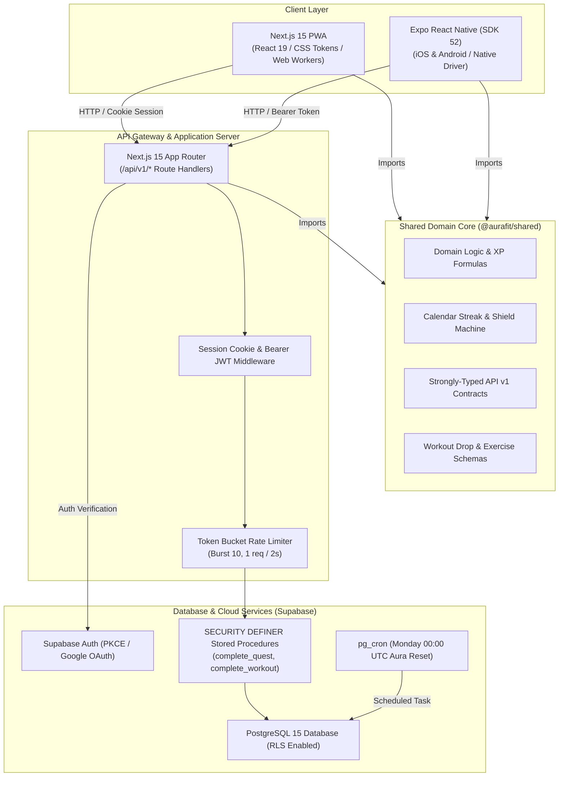
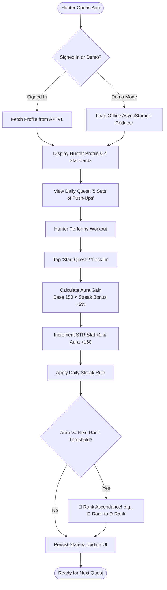
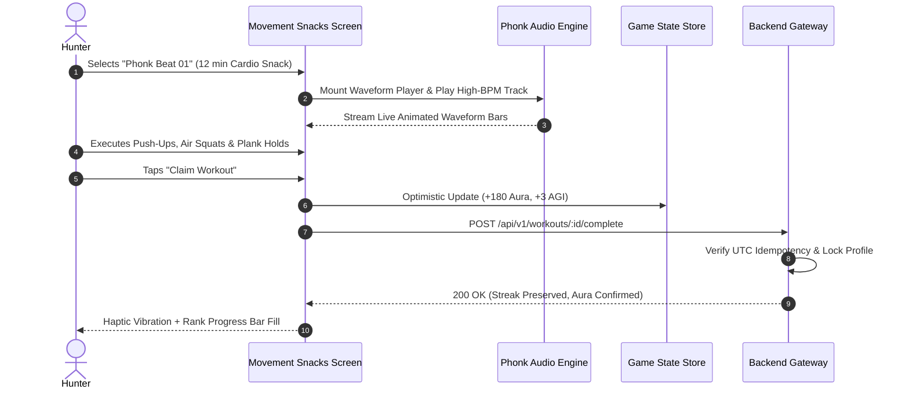
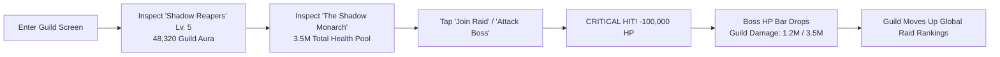

# AuraFit — RPG Gamified Fitness Platform

<p align="center">
  
</p>

<p align="center">
  <strong>Level Up Your Body. Claim Your Aura.</strong><br/>
  <em>A next-generation gamified fitness engine where Solo Leveling meets real-world habit building.</em>
</p>

<p align="center">
  
  
  
  
  
  
  
</p>

---

## ⚡ Overview

**AuraFit** transforms fitness into an immersive RPG journey inspired by the anime and manhwa *Solo Leveling*. Daily push-up sets, sprints, mobility drills, and curated high-intensity "Movement Snacks" earn **Aura Points**, power up four core RPG attributes (**STR**, **AGI**, **END**, **REC**), and advance users through seven hunter ranks from **E-Rank** to **Monarch**.

The platform is designed as an **npm workspaces monorepo** with a single shared domain engine powering two high-performance clients:
- 🌐 **Web**: An installable, responsive Progressive Web App built with **Next.js 15**, React 19, and standalone Docker deployment.
- 📱 **Mobile**: A native iOS and Android application built with **Expo SDK 52** and React Native, featuring deep obsidian aesthetics, offline-first local state fallback, and high-contrast WCAG-compliant typography.

---

## 🏛️ System Architecture

AuraFit decouples pure business and game domain logic from presentation layers, ensuring consistent calculations across web, mobile, and server environments.



> 📖 **Deep Dive**: See the full architectural specification, ER diagram, and caching strategy in [**`docs/ARCHITECTURE.md`**](file:///Users/admin/.gemini/antigravity-ide/scratch/aurafit/docs/ARCHITECTURE.md).

---

## 🔄 User Flows & Core Game Loops

### 1. Hunter Daily Quest & Level-Up Loop



---

### 2. Movement Snacks & Phonk Beat Workout Drop



---

### 3. Guild World Boss Raid Loop



---

## 🎮 Game Engine & Business Logic Highlights

AuraFit's mechanics are mathematically formalized in `@aurafit/shared`:

### 1. Aura Progression Formula
$$\text{AuraEarned} = \text{round}\left( \frac{\text{BaseReward} \times \text{Multiplier} \times (100 + \min(\text{StreakDays} \times 5, 50))}{100} \right)$$
- Every consecutive workout day yields a **+5% boost** (up to a **+50% maximum** at 10+ days).

### 2. Hunter Rank Progression Ladder
| Rank | Threshold | Visual Theme | Next Milestone |
|---|:---:|---|---|
| **E-Rank** | `0 Aura` | Deep Obsidian & Metallic Silver | +1,000 to D-Rank |
| **D-Rank** | `1,000 Aura` | Slate Blue & Steel | +2,000 to C-Rank |
| **C-Rank** | `3,000 Aura` | Electric Cyan Glow | +4,000 to B-Rank |
| **B-Rank** | `7,000 Aura` | Neon Emerald Surge | +8,000 to A-Rank |
| **A-Rank** | `15,000 Aura` | Royal Violet Energy | +15,000 to S-Rank |
| **S-Rank** | `30,000 Aura` | Crimson Flame Aura | +30,000 to Monarch |
| **Monarch** | `60,000 Aura` | Gold & Shadow Amethyst | Pinnacle Hunter Realm |

### 3. Core RPG Attributes
- **STR (Strength)**: Built through heavy lifts and bodyweight resistance.
- **AGI (Agility)**: Leveled up via high-cadence cardio snacks and metcon drills.
- **END (Endurance)**: Scaled through sustained workouts and long-duration drops.
- **REC (Recovery)**: Nurtured via mobility sessions, stretching, and rest day resets.

### 4. Streak Shield State Machine
A calendar-day UTC state machine protects hunter streaks:
- Missed 1 day with $\ge 1$ **Streak Shield**: Shield automatically consumed; streak continues unbroken.
- Missed $\ge 2$ days: Streak resets to 1; remaining shields stay preserved.

> 📖 **Deep Dive**: See complete formulas, database triggers, and SQL idempotency in [**`docs/BUSINESS_LOGIC.md`**](file:///Users/admin/.gemini/antigravity-ide/scratch/aurafit/docs/BUSINESS_LOGIC.md).

---

## 🛠️ Technology Stack

| Domain | Technology | Purpose |
|---|---|---|
| **Monorepo Architecture** | npm Workspaces + Turborepo | Isolated package caching and monorepo script orchestration |
| **Shared Core Package** | TypeScript 5.x | Pure domain logic, XP math, Zod/schemas, API contract interfaces |
| **Mobile App** | Expo SDK 52 / React Native 0.76+ | High-performance iOS and Android cross-platform client |
| **Mobile State & Storage** | `@react-native-async-storage` | Zero-latency offline-first state reducer for demo & offline modes |
| **Web Application** | Next.js 15 (App Router) + React 19 | Server-side rendering, standalone container builds, installable PWA |
| **Database & Identity** | Supabase (PostgreSQL 15) | Row-Level Security (RLS), column grants, OAuth PKCE, stored procedures |
| **Background Scheduling**| `pg_cron` | Monday 00:00 UTC weekly aura reset & maintenance routines |
| **Icons & Design Tokens** | Lucide Icons + HSL Obsidian Theme | Custom design system with tailored dark obsidian palettes (`#070A12`, `#0D1322`) |
| **Testing Suite** | Vitest 3.x + PGlite | 237 automated tests across game math, API routes, and SQL schema migrations |
| **Build & Deployment** | EAS Build + Docker + Vercel | Native app store binaries (iOS/Android) and standalone web container |

---

## 📁 Repository Structure

```
.
├── packages/
│   └── shared/               # @aurafit/shared: domain logic (ranks, aura, streaks, drops)
│       ├── src/              # TypeScript source, compiled to dist/ (CJS + ESM + .d.ts)
│       │   ├── api.ts        # HTTP API v1 request/response types (shared contract)
│       │   ├── streak.ts     # Calendar-day streak & shield state machine
│       │   ├── drops.ts      # Workout drop schema & validators
│       │   └── index.ts      # Hunter ranks, attributes, formulas & permissions
│       ├── test/             # 237 Vitest tests (+ PGlite migration tests)
│       └── schema.sql        # Cumulative database schema concatenation
├── apps/
│   ├── web/                  # Next.js 15 App Router PWA
│   │   ├── src/app/          # Routes (/, /demo, /arena, /account) & API routes (/api/v1/*)
│   │   ├── src/components/   # Web UI component library
│   │   └── public/           # manifest.json, sw.js, and static artwork
│   └── mobile/               # Expo SDK 52 mobile application
│       ├── src/components/   # HunterHeroCard, StatCardsRow, DailyQuestHeroCard, etc.
│       ├── src/screens/      # MemberScreen, GuildScreen, MovementSnacksScreen
│       ├── src/hooks/        # useGameStore (offline state), useApi hooks
│       ├── src/theme/        # Obsidian design system tokens & ThemeProvider
│       └── assets/           # Local avatars, logo vectors, and audio samples
├── supabase/
│   ├── migrations/           # Idempotent versioned SQL migrations
│   └── seed/                 # Seed data for demo drops and creators
├── docs/
│   ├── ARCHITECTURE.md       # Technical architecture, ER diagrams, data flow
│   ├── BUSINESS_LOGIC.md     # Game mechanics, XP formulas, streak state machine
│   ├── MARKETING_GUIDE.md    # GTM strategy, TikTok hooks, personas, ASO playbook
│   └── STORE_LISTING.md      # Google Play Store listing in English (UK)
└── scripts/
    └── db-sync.mjs           # Regenerates schema.sql from supabase/migrations/*
```

---

## 🚀 Getting Started

### Prerequisites
- **Node.js**: `22.x` (see [`.nvmrc`](file:///Users/admin/.gemini/antigravity-ide/scratch/aurafit/.nvmrc); run `nvm use`)
- **npm**: `10+` (bundled with Node 22)
- **Expo Go App** (optional): On your physical iOS or Android device

### 1. Installation & Initial Build
```bash
# Clone the repository
git clone https://github.com/drdhavaltrivedi/aurafit.git
cd aurafit

# Ensure correct Node version & install dependencies
nvm use
npm ci

# Compile the shared domain package (MUST be built before running apps)
npm run build:shared
```

---

### 2. Running Locally

#### Run the Web App (Next.js 15 PWA)
```bash
npm run dev:web
# -> Open http://localhost:3000 in your browser
```
*Health check endpoint*: `GET http://localhost:3000/api/health`

#### Run the Mobile App (Expo SDK 52)
```bash
npm run dev:mobile
# -> Displays interactive terminal menu & QR code
# -> Press 'i' for iOS simulator, 'a' for Android emulator, or scan with Expo Go
```

---

### 3. Testing & Code Quality

```bash
# Run the complete test suite (237 unit & schema tests)
npm test

# Run TypeScript typechecks across shared, web, and mobile
npm run typecheck

# Run web linter
npm run lint --workspace=apps/web
```

---

## 🔒 Environment Variables

All variables are optional for initial local exploration (the app automatically falls back to offline **Demo Mode**):

```bash
# Copy template to web app
cp .env.example apps/web/.env.local
```

| Variable | Scope | Purpose |
|---|---|---|
| `NEXT_PUBLIC_SUPABASE_URL` | Web Client | Supabase project URL |
| `NEXT_PUBLIC_SUPABASE_PUBLISHABLE_KEY` | Web Client | Supabase publishable anonymous key |
| `SUPABASE_SECRET_KEY` | Web Server Only | Service role key for admin stored procedures |
| `EXPO_PUBLIC_API_URL` | Mobile App | URL of the Next.js API Gateway (e.g. `http://localhost:3000`) |
| `EXPO_PUBLIC_SUPABASE_URL` | Mobile App | Supabase project URL for native auth |
| `EXPO_PUBLIC_SUPABASE_ANON_KEY` | Mobile App | Supabase anonymous key for mobile client |

---

## 🚢 Production Deployment

### Web (Docker Standalone)
```bash
# Build production Docker image
docker build -f apps/web/Dockerfile -t aurafit-web .

# Run container locally
docker run --rm -p 3000:3000 --env-file apps/web/.env.local aurafit-web
```

### Mobile (Expo Application Services - EAS)
```bash
# Authenticate with EAS
npm i -g eas-cli
eas login

# Build standalone Android and iOS binaries
cd apps/mobile
eas build --platform all --profile production

# Submit directly to stores
eas submit --platform all --profile production
```
*Package identifier*: `com.brilworks.aurafit`

---

## 📚 Complete Documentation Index

| Document | Content & Purpose |
|---|---|
| 📐 [**`docs/ARCHITECTURE.md`**](file:///Users/admin/.gemini/antigravity-ide/scratch/aurafit/docs/ARCHITECTURE.md) | System topology, database ER diagram, API v1 contracts, security model, and offline sync. |
| ⚔️ [**`docs/BUSINESS_LOGIC.md`**](file:///Users/admin/.gemini/antigravity-ide/scratch/aurafit/docs/BUSINESS_LOGIC.md) | Game engine rules, XP equations, rank ascendance thresholds, streak shield state machine, and boss raids. |
| 📈 [**`docs/MARKETING_GUIDE.md`**](file:///Users/admin/.gemini/antigravity-ide/scratch/aurafit/docs/MARKETING_GUIDE.md) | Go-To-Market strategy, user personas, viral TikTok loops, App Store Optimization (ASO), and Hunter Pass monetization. |
| 📱 [**`docs/STORE_LISTING.md`**](file:///Users/admin/.gemini/antigravity-ide/scratch/aurafit/docs/STORE_LISTING.md) | Complete Google Play Store listing in **English (United Kingdom) – `en-GB`** with character limits. |

---

## 📄 License

This project is licensed under the **MIT License** — see the [LICENSE](file:///Users/admin/.gemini/antigravity-ide/scratch/aurafit/LICENSE) file for details.
