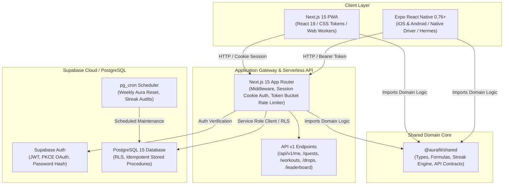
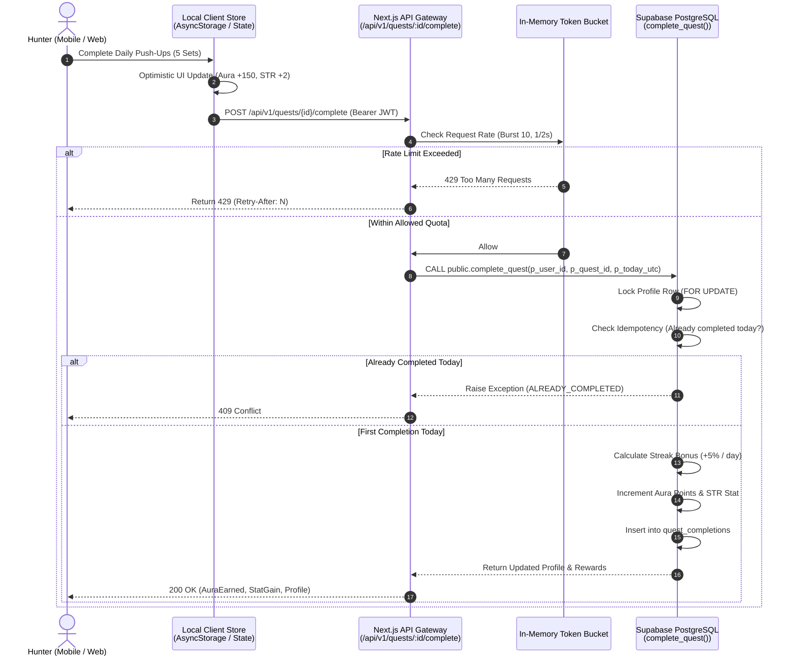
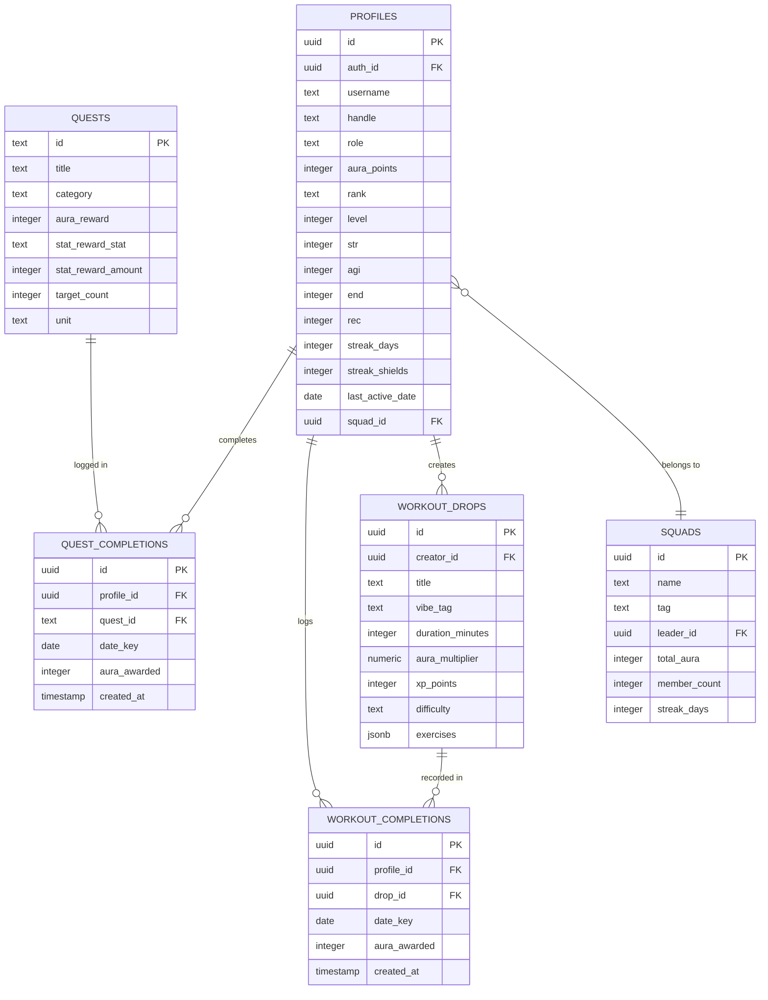
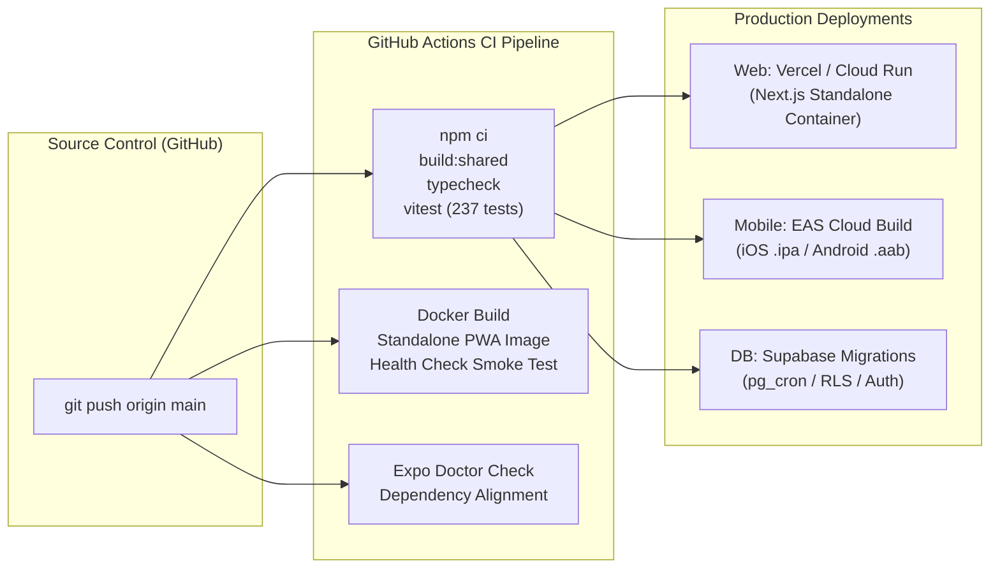

# AuraFit Technical Architecture

AuraFit is a cross-platform, gamified fitness platform engineered for high performance, offline resilience, and real-time RPG progression. This document outlines the system architecture, component topologies, data flow lifecycles, database entity relationships, security models, and deployment pipelines.

---

## 1. High-Level Architecture Overview

AuraFit is architected as an **npm workspaces monorepo** consisting of two client applications, a domain logic package, and a cloud-native backend built on Supabase (PostgreSQL with Row Level Security, Auth, and Storage).



---

## 2. Monorepo Structure & Package Hierarchy

```
aurafit/
├── packages/
│   └── shared/               # @aurafit/shared (Single source of domain truth)
│       ├── src/
│       │   ├── index.ts      # Hunter ranks, stats, XP formulas, roles & permissions
│       │   ├── api.ts        # Strongly-typed HTTP API v1 request/response contracts
│       │   ├── streak.ts     # Idempotent calendar-day streak & shield state machine
│       │   ├── drops.ts      # Workout drop schema & validation engine
│       │   ├── limits.ts     # Input length & payload safety limits
│       │   └── icons.ts      # Canonical icon key mappings
│       ├── test/             # Vitest test suite (+ PGlite migration verification)
│       └── schema.sql        # Cumulative database schema concatenation
├── apps/
│   ├── web/                  # Next.js 15 App Router Progressive Web App
│   │   ├── src/app/          # Routes, layouts, and /api/v1/* route handlers
│   │   ├── src/components/   # Design system UI components (obsidian palette)
│   │   ├── src/lib/          # Server API handlers, auth validators, client SDK
│   │   └── public/           # Manifest, service worker, audio & visual assets
│   └── mobile/               # Expo SDK 52 (React Native) mobile application
│       ├── src/components/   # Mobile UI components (Hero cards, stat rows, tab bar)
│       ├── src/screens/      # Member home, Guild World Boss raid, Movement Snacks
│       ├── src/hooks/        # useGameStore (offline-first state), useApi query hooks
│       ├── src/theme/        # Obsidian theme tokens & WCAG high-contrast provider
│       └── assets/           # Local avatars, logo vectors, and splash assets
├── supabase/
│   ├── migrations/           # Versioned SQL migrations (source of truth)
│   └── seed/                 # Sample workout drops and creator profiles
└── docs/                     # Engineering, business logic, marketing & ASO specs
```

---

## 3. Client Architecture & State Management

### 3.1 Dual-Mode Operation (Offline Demo vs. Server Sync)

Both clients support two operational modes:
1. **Demo Mode (Zero-Config / Offline-First)**:
   - Operates entirely locally with pre-seeded hunter profiles, daily quests, and workout drops.
   - Mobile persists state to `@react-native-async-storage/async-storage` via an immutable action reducer (`useGameStore`).
   - Web persists state to browser `localStorage`.
   - Allows users to test role switching (`MEMBER`, `CREATOR`, `ADMIN`) and all RPG mechanics without network connectivity.
2. **Server-Connected Mode**:
   - Authenticated against Supabase Auth using session cookies (Web) or Bearer access tokens (Mobile).
   - Queries and mutations interact with `/api/v1/*` endpoints.
   - Synchronizes offline progress upon re-establishing connection.



---

## 4. Database Architecture & Entity Relationships

The database is built on PostgreSQL with Row Level Security (RLS) enabled on every public table. Business mutations occur via `SECURITY DEFINER` stored procedures granted strictly to the `service_role`.



---

## 5. Security & Access Control Model

### 5.1 Role-Based Permissions Matrix

Permissions are validated both at the client boundary (via `@aurafit/shared:hasPermission`) and enforced strictly at the database/API layer.

| Permission | `MEMBER` | `CREATOR` | `ADMIN` | Purpose |
|---|:---:|:---:|:---:|---|
| `DO_QUESTS` | Yes | Yes | Yes | Execute daily quests and claim stat boosts |
| `START_WORKOUT` | Yes | Yes | Yes | Complete workout drops and gain aura |
| `JOIN_SQUAD` | Yes | Yes | Yes | Participate in squads and guild raids |
| `VIEW_GYM_LEADERBOARD` | Yes | Yes | Yes | Read regional and global leaderboards |
| `PUBLISH_WORKOUT_DROP` | No | Yes | Yes | Author and publish community workouts |
| `VIEW_CREATOR_ANALYTICS` | No | Yes | Yes | Access engagement metrics on published drops |
| `MANAGE_SQUAD_MEMBERS` | No | Yes | Yes | Invite, promote, or kick squad members |
| `MANAGE_GYM_AFFILIATION`| No | No | Yes | Manage affiliated gyms and commercial badges |
| `AUDIT_ANTI_CHEAT` | No | No | Yes | Inspect suspicious aura surges & bot activity |
| `ADJUST_AURA_ECONOMY` | No | No | Yes | Modify base rewards and tier multipliers |
| `ASSIGN_USER_ROLES` | No | No | Yes | Elevate users to CREATOR or ADMIN |

### 5.2 Network & Header Security
- **Content Security Policy (CSP)**: Strict origin whitelisting in `apps/web/next.config.mjs` restricting scripts, frames, and connect endpoints.
- **Strict Transport Security (HSTS)**: 2-year max-age with preload directive.
- **Frame Busting**: `X-Frame-Options: DENY` and `frame-ancestors 'none'` to protect against clickjacking.
- **In-Memory Token Bucket**: Every mutating API endpoint (`POST /quests`, `POST /workouts`, `POST /drops`) is wrapped with an IP/User-based rate limiter (Burst: 10, sustained: 1 request / 2 seconds).

---

## 6. Build & Deployment Lifecycle


