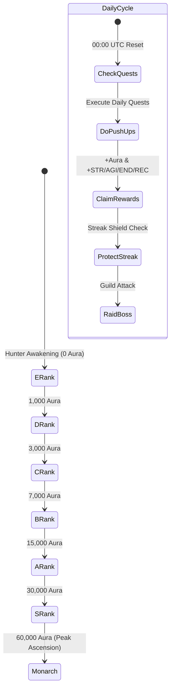
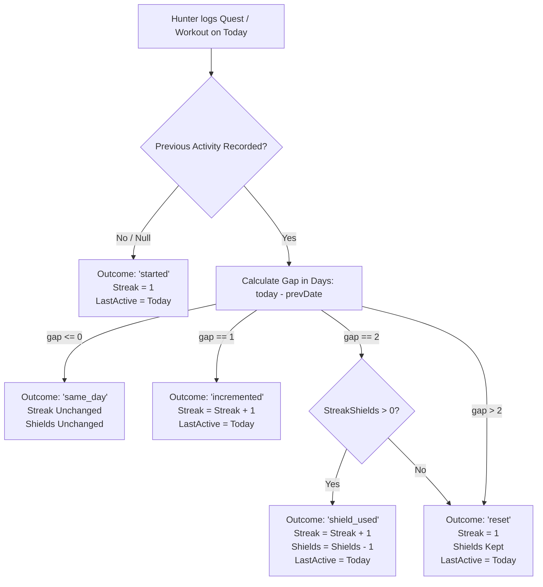
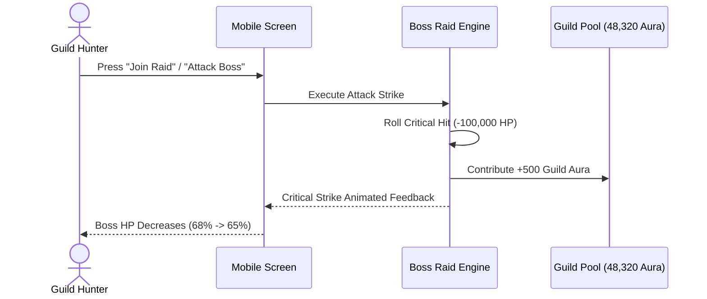

# AuraFit Business Logic & Game Engine Specification

AuraFit gamifies real-world physical activity by translating daily workouts, push-up sets, and mobility sessions into an immersive **Solo Leveling-style RPG experience**. This document details the mathematical models, game rules, progression formulas, and anti-cheat constraints powering the platform.

---

## 1. Core Vision & The "Hunter" Loop

Every user enters AuraFit as an **E-Rank Hunter** with baseline RPG attributes. Through consistent physical movement, completing daily quests, and joining guild boss raids, hunters level up, protect their streaks, and climb toward **S-Rank** and **Monarch** status.



---

## 2. Aura Points Economy & Mathematical Models

### 2.1 Aura Formula
Aura is the primary XP currency in AuraFit. Aura earned from any activity (quest or workout drop) is computed using the canonical formula implemented in [`packages/shared/src/index.ts`](file:///Users/admin/.gemini/antigravity-ide/scratch/aurafit/packages/shared/src/index.ts#L263-L274):

$$\text{AuraEarned} = \text{round}\left( \frac{\text{BaseReward} \times \text{Multiplier} \times (100 + \text{StreakBonus})}{100} \right)$$

Where:
- $\text{BaseReward}$: Integer XP allocated to the workout drop or quest (e.g. 150 Aura for Daily Push-Ups).
- $\text{Multiplier}$: Difficulty / creator bonus factor (e.g., $1.5\times$ for high-intensity Phonk drops).
- $\text{StreakBonus}$: Progressive percentage boost:
  $$\text{StreakBonus} = \min(\text{StreakDays} \times 5, 50)$$
  - Day 1: $+5\%$
  - Day 2: $+10\%$
  - Day 5: $+25\%$
  - Day 10+: $+50\%$ (Hard Cap)

### 2.2 Economy Safeguards
1. **Per-Action Cap**: Single reward payouts are capped at **5,000 Aura** to prevent integer overflows and glitch exploits.
2. **Weekly Reset (Decay Prevention)**: To keep competition active, `weeklyAuraGained` resets to `0` every **Monday at 00:00 UTC** via the `aurafit-weekly-aura-reset` `pg_cron` worker. Lifetime `aura_points` are permanently preserved.

---

## 3. Hunter Rank Ascendance Engine

Hunters advance through seven distinct rank tiers based on their total lifetime Aura:

| Rank | Aura Threshold | Progression Span | Required Points | Visual Crest Palette |
|---|:---:|:---:|:---:|---|
| **E-RANK** | `0` | `1,000` | 1,000 Aura to D | Obsidian & Silver `#94A3B8` |
| **D-RANK** | `1,000` | `2,000` | 2,000 Aura to C | Slate Blue `#64748B` |
| **C-RANK** | `3,000` | `4,000` | 4,000 Aura to B | Electric Cyan `#06B6D4` |
| **B-RANK** | `7,000` | `8,000` | 8,000 Aura to A | Neon Emerald `#10B981` |
| **A-RANK** | `15,000` | `15,000` | 15,000 Aura to S | Royal Violet `#8B5CF6` |
| **S-RANK** | `30,000` | `30,000` | 30,000 Aura to Monarch | Crimson Fire `#EF4444` |
| **MONARCH** | `60,000` | `MAX` | Highest Realm | Neon Gold & Amethyst `#F59E0B` |

### Progress Calculation
$$\text{ProgressToNextRank} = \min\left(99, \left\lfloor \frac{\text{Aura} - \text{CurrentThreshold}}{\text{NextThreshold} - \text{CurrentThreshold}} \times 100 \right\rfloor \right)$$
*Note: The progress percentage floors at 99% until the next threshold is strictly reached to prevent false 100% completion states.*

---

## 4. Core RPG Player Attributes

Every Hunter tracks four core attributes bounded between `0` and `100`:

```
                 [ STR ]
            Strength / Power
                   ▲
                   │
  [ REC ] ─────────┼───────── [ AGI ]
Recovery / Mobility│     Agility / Speed
                   │
                   ▼
                 [ END ]
            Endurance / Cardio
```

1. **STR (Strength)**: Gained via heavy compound movements, push-up reps, and bodyweight power training.
2. **AGI (Agility)**: Gained via fast HIIT drops, sprint intervals, and jump rope movement snacks.
3. **END (Endurance)**: Gained via distance running, steady-state cycling, and long-duration drops.
4. **REC (Recovery)**: Gained via thoracic spine mobility resets, yoga sessions, and active cooldowns.

---

## 5. Daily Streak & Shield State Machine

AuraFit's streak engine ([`packages/shared/src/streak.ts`](file:///Users/admin/.gemini/antigravity-ide/scratch/aurafit/packages/shared/src/streak.ts)) uses UTC calendar dates (`YYYY-MM-DD`) to eliminate timezone manipulation.



### Streak Rules Summary
- **At Most Once per UTC Day**: Multiple workouts on the same calendar day reinforce stats and aura, but increment the streak counter only once.
- **Single Missed Day**: If a hunter misses exactly 1 day and has $\ge 1$ **Streak Shield**, the shield is auto-consumed, saving the streak.
- **Multiple Missed Days**: Two or more consecutive missed days result in a streak reset to 1; shields remain in inventory for future protection.

---

## 6. Guilds & World Boss Raid Mechanics

Hunters collaborate in squads and guilds (such as **Shadow Reapers**) to challenge community World Bosses.



1. **Shared Guild Aura**: Sum of all member aura contributions, driving guild rank levels (Lv. 1 to Lv. 10).
2. **World Boss Health Pools**: Multi-million HP bosses (e.g., "The Shadow Monarch" - 3.5M HP) with server-wide countdown timers.
3. **Interactive Raid Strikes**: Gamified attack buttons with real-time HP depletion animations and damage leaderboards.

---

## 7. Movement Snacks & Phonk Workouts

Designed for gamers, desk workers, and students who cannot spend 2 hours in a gym:

- **Format**: 5 to 15-minute high-intensity drops.
- **Music Synchronization**: Integrated high-energy Phonk audio tracks (120–160 BPM) with animated audio waveform visualizations.
- **Micro-Dose Frequency**: Built to reset posture, activate glutes, and raise heart rates between desk sessions.
