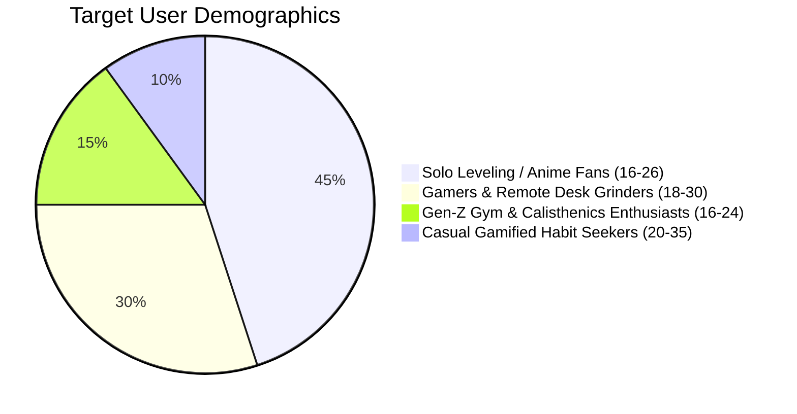
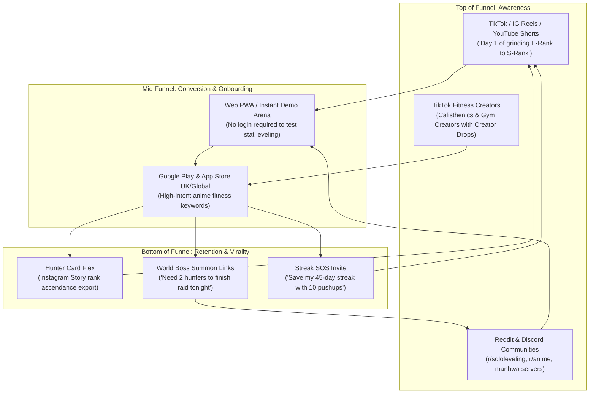

# AuraFit Go-To-Market & Marketing Playbook

AuraFit transforms the boring, repetitive chore of fitness into a high-octane **Solo Leveling anime RPG quest**. This playbook outlines our positioning, audience personas, viral growth loops, App Store Optimization (ASO) roadmap, creator partnerships, and monetization strategy.

---

## 1. Executive Summary & Brand Positioning

### 1.1 The Market Problem
Traditional fitness apps (MyFitnessPal, Apple Fitness, Strava) are engineered for triathletes, bodybuilders, or corporate step-counters. They are visually sterile, spreadsheet-heavy, and fail to engage Gen Z and Gen Alpha users who grew up on gaming, anime, and short-form video culture.

### 1.2 The AuraFit Solution
AuraFit merges the dopamine loops of **Solo Leveling** and **RPG gaming** with evidence-based physical training:
- **Gamified Stats**: Physical effort directly upgrades STR, AGI, END, and REC.
- **Micro-Dosing Fitness**: 10–15 minute "Movement Snacks" that fit between gaming sessions or remote work blocks.
- **Audio-Driven Motivation**: Hard-hitting Phonk workout beats with live animated waveforms.
- **Squad Accountability**: Guilds, World Boss raids, and streak protection shields.

**Core Tagline**: *"Level Up Your Body. Claim Your Aura."*

---

## 2. Target Audience & Buyer Personas



### Persona 1: "The Aspiring Hunter" (Ethan, 20)
- **Profile**: College student, avid watcher of *Solo Leveling*, *Jujutsu Kaisen*, and reader of manhwa.
- **Pain Point**: Intimidated by traditional gym bro culture; wants Jinwoo's physical transformation but lacks routine.
- **Hook**: "Awaken as an E-Rank hunter and unlock your real-world stat window."

### Persona 2: "The Desk Grinder" (Maya, 25)
- **Profile**: Junior software developer / gamer sitting 10+ hours a day with deteriorating posture.
- **Pain Point**: Cannot commit to 90-minute gym trips; experiences neck strain and low energy.
- **Hook**: "10-minute Movement Snacks with posture resets and Phonk beats between coding sprints."

### Persona 3: "The Streak Competitor" (Liam, 19)
- **Profile**: Duolingo 300-day streaker, competitive gamer, gym lifter.
- **Pain Point**: Quits fitness apps when a single missed day erases all progress.
- **Hook**: "Streak shields protect your progress; compete on global squad leaderboards."

---

## 3. Go-To-Market (GTM) Strategy & Acquisition Channels



---

## 4. Short-Form Video Content Strategy (TikTok / Reels / Shorts)

The primary growth engine is short-form organic video tapping into existing anime fitness trends:

### Proven Content Hooks
1. **The System Awakening**:
   - *Video*: Opening the AuraFit app screen in a dimly lit gym while dark Phonk music drops: *"The System granted me a daily quest: 100 pushups or my rank decays."*
2. **E-Rank to S-Rank IRL Transformation**:
   - *Video*: Split-screen progression tracking physical body transformation alongside AuraFit Hunter Card level ups (Level 1 E-Rank $\to$ Level 35 A-Rank).
3. **Movement Snack POV**:
   - *Video*: Desk worker slumping in office chair, phone notifications buzz: *"Daily Quest: 5-minute thoracic reset + 30 air squats."* Quick montage, posture restored, +150 Aura.

---

## 5. App Store Optimization (ASO) Playbook

### 5.1 Primary Keyword Clusters

| Category | Primary Keywords | Secondary Long-Tail Keywords |
|---|---|---|
| **Anime & RPG** | `Solo Leveling workout`, `anime fitness app`, `RPG workout` | `level up fitness game`, `hunter system workout`, `anime gym quest` |
| **Habit & Streaks** | `daily quest tracker`, `streak fitness`, `workout habit` | `push up daily challenge`, `habit RPG streak shield` |
| **Movement Snacks** | `quick workout`, `desk exercises`, `10 min fitness` | `movement snacks phonk`, `posture reset workout for gamers` |

### 5.2 5-Screenshot Carousel Storyline
- **Screenshot 1**: **"AWAKEN YOUR INNER HUNTER"** (Hero Hunter profile card, E-Rank crest, dark obsidian glow).
- **Screenshot 2**: **"REAL LIFE RPG ATTRIBUTES"** (4-card stat row: STR, AGI, END, REC leveling up).
- **Screenshot 3**: **"DAILY QUESTS & STREAK SHIELDS"** (Push-ups quest card with "+150 Aura" and streak protection).
- **Screenshot 4**: **"PHONK MOVEMENT SNACKS"** (10-15 min drops with animated audio waveform player).
- **Screenshot 5**: **"GUILD RAIDS & WORLD BOSSES"** (Shadow Reapers attacking The Shadow Monarch with critical hit feedback).

*(Complete Google Play listing metadata in `en-GB` is documented in [`docs/STORE_LISTING.md`](file:///Users/admin/.gemini/antigravity-ide/scratch/aurafit/docs/STORE_LISTING.md)).*

---

## 6. Virality Loops & Retention Mechanics

```
               [ Hunter Levels Up ]
                        │
                        ▼
           [ Hunter Card Instagram Export ]
                        │
                        ▼
      [ Friend clicks: "Become a Hunter" link ]
                        │
                        ▼
        [ Joins Hunter's Guild / Squad ]
                        │
                        ▼
   [ Both earn +200 Aura & 1 Streak Shield ]
```

1. **The Hunter Card Flex**: One-tap native sharing generates a custom Instagram Story/TikTok sticker displaying the user's username, rank crest, level, and 4 RPG stats.
2. **Streak SOS (Friend Recovery)**: If a hunter misses a day with 0 shields remaining, they can send a "Streak SOS" link to a friend. If the friend completes a 5-minute movement snack, the streak is restored!
3. **World Boss Raid Summon**: Boss raid timers encourage squad leaders to ping their Discord groups to deal damage before the Sunday midnight deadline.

---

## 7. Monetization Strategy: The Hunter Pass

AuraFit adopts an ethical freemium model where core fitness, daily quests, and rank progression are **100% free**, while cosmetic perks, exclusive audio, and advanced RPG enhancements form the **Hunter Elite** tier:

| Feature | Free Tier | Hunter Elite (£6.99/mo or £49.99/yr) |
|---|:---:|:---:|
| Daily Hunter Quests & Stats | Unlimited | Unlimited |
| Movement Snacks & Standard Workouts | Yes | Yes |
| Guild Raids & Squad Access | Yes | Yes |
| **Streak Shield Capacity** | 1 Shield Max | **Up to 5 Shields Stored** |
| **Exclusive Phonk Soundtracks** | 3 Base Tracks | **Full Phonk Vault (30+ High-BPM Tracks)** |
| **Cosmetic Avatar Customization** | Standard Frame | **Animated Shadow Flames & Neon Rank Crests** |
| **Advanced Biometric Insights** | Basic Stats | **Recovery Readiness & Power Velocity Charts** |
| **Creator Drop Publishing** | Read-Only | **Publish Custom Drops & Earn Royalties** |
